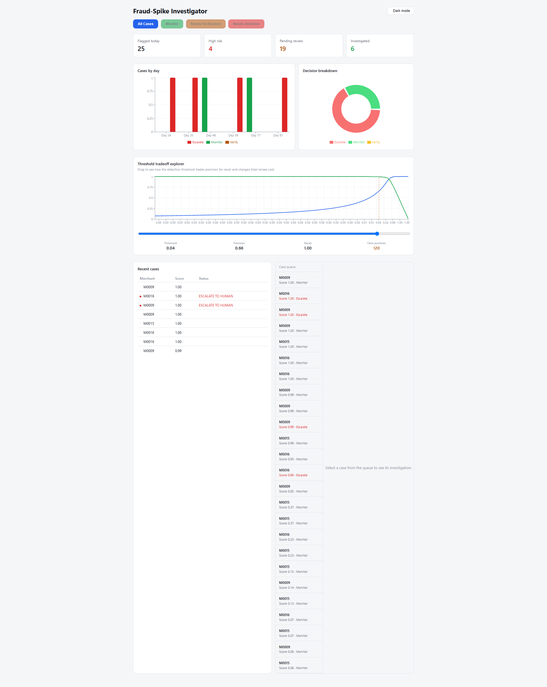
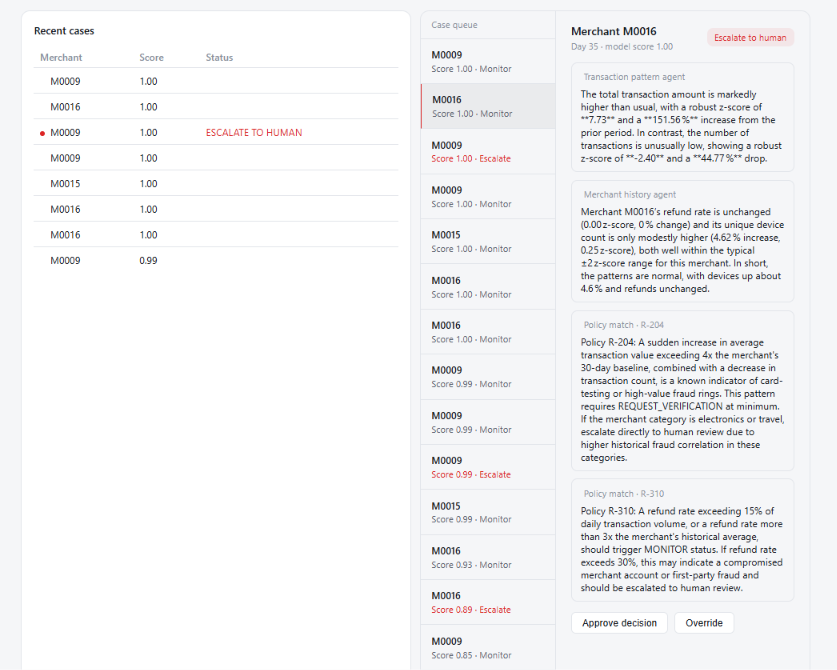

# TraceX
 
> An AI-native merchant risk investigation system — built for the **Razorpay AI Buildathon 2026**, "AI Risk Manager" track. Detects abnormal merchant behaviour (transaction spikes and refund abuse) with real, evaluated ML models, then runs a multi-agent investigation layer that explains *why* a merchant was flagged and cites the internal policy that applies.
 


 
---

## Screenshots

## Dashboard

<p align="center">
  
</p>

## Case Investigation

<p align="center">
  
</p>


---
 
## Table of Contents
 
1. [Problem Statement](#problem-statement)
2. [Why This Approach](#why-this-approach)
3. [System Architecture](#system-architecture)
4. [Tech Stack](#tech-stack)
5. [ML Detection Layer](#ml-detection-layer)
6. [Agent Investigation Layer](#agent-investigation-layer)
7. [Backend API](#backend-api)
8. [Frontend Dashboard](#frontend-dashboard)
9. [Evaluation Results](#evaluation-results)
10. [Testing & CI](#testing--ci)
11. [Project Structure](#project-structure)
12. [Setup & Running Locally](#setup--running-locally)
13. [What's In Scope vs. Deliberately Out of Scope](#whats-in-scope-vs-deliberately-out-of-scope)
14. [Security & Reliability Considerations](#security--reliability-considerations)

---
 
## Problem Statement
 
Payment platforms process millions of transactions across thousands of merchants. Risk teams need to catch abnormal merchant behaviour — sudden transaction spikes, unusual ticket sizes, refund surges, collusive refunds, device fan-out — early enough to act, without drowning analysts in false positives.
 
Most fraud-detection demos either output a bare risk score with no explanation, or wrap an LLM around raw data and let it "decide" risk with no real detection model underneath, no measured accuracy, and no accountability for being wrong.
 
**This project scopes to two loss classes — merchant transaction-velocity/amount spikes and refund abuse — and treats evaluation as the deliverable, not an afterthought.** The system:
- Detects anomalies with trained, evaluated ML models (not an LLM)
- Investigates *why* a flagged case looks risky using a small set of specialised agents
- Cites the specific internal policy driving each decision (RAG-based)
- Reports honest precision/recall and false-positive cost — including how often it wrongly flags legitimate events like flash sales and post-festival return waves

## Why This Approach
 
A core design principle throughout: **the LLM explains, it never decides.** Every score, threshold, and action mapping is deterministic code. Agents narrate real feature values and real SHAP attributions — they don't generate risk assessments from scratch. This keeps the system auditable and prevents hallucinated reasoning from driving financial decisions.

A second principle: **a loss class is configuration, not a rewrite.** Each class has its own signals, labels, model, threshold, cost curve and policies, registered in one place. The feature recipe, evaluation method, agent graph, API and database are shared.
 
## System Architecture
 
```
Synthetic Transaction Data (per-merchant daily aggregates, one dataset per loss class)
        ↓
Feature Engineering (rolling robust z-scores, % change, merchant-relative baselines)
        ↓
ML Detector per loss class (XGBoost + SHAP; Isolation Forest / z-score baselines for comparison)
        ↓
Should Investigate? (per-class, cost-optimal threshold gate)
   ├─ NO  → logged, no action
   └─ YES ↓
   LangGraph Orchestrator — routes by loss class
        ├─ Transaction spike path
        │    ├─ Transaction Pattern Agent  — velocity/amount signal from real features
        │    └─ Merchant History Agent     — today vs. this merchant's own baseline
        ├─ Refund abuse path
        │    ├─ Refund Pattern Agent               — rate, refund size, refund speed
        │    └─ Refund Concentration & Timing Agent — repeat customers, post-settlement refunds
        └─ Policy Agent (RAG) — retrieves policies for this loss class, zero LLM calls
        ↓
   Evidence Agent — merges findings, cites policy, checked against SHAP ground truth
        ↓
   Decision Agent — deterministic mapping: (score, policy) → ALLOW / MONITOR /
                     REQUEST_VERIFICATION / ESCALATE_TO_HUMAN
        ↓
FastAPI backend — case logging, human override endpoint, dashboard APIs
        ↓
React dashboard — loss-class tabs, case queue + evidence panel (risk-analyst tool, not a chatbot)
```
 
## Tech Stack
 
| Layer | Choice | Why |
|---|---|---|
| ML detection | scikit-learn (Isolation Forest), XGBoost, SHAP | Explainable, fast to train, industry-standard for tabular anomaly/fraud detection |
| Agent orchestration | LangGraph + Groq (`openai/gpt-oss-20b`) | Structured, short, evidence-grounded reasoning — a fast/cheap model is the right fit; the LLM never sets the score |
| Policy retrieval | ChromaDB + sentence-transformers (`all-MiniLM-L6-v2`) | Local embeddings, zero API cost for retrieval; policies are tagged by loss class and filtered at query time |
| Backend | FastAPI + SQLAlchemy + SQLite | Lightweight, zero-ops persistence appropriate for project scope |
| Frontend | React (Vite) + Recharts | Fast iteration, component-based, matches a dense analyst-tool UI with light/dark themes |
| Quality | pytest, GitHub Actions, Docker Compose | Decision logic is unit-tested without LLM calls; the whole stack starts with one command |
 
## ML Detection Layer

Both loss classes share the same method: per-merchant rolling robust z-scores (median + MAD over 14 days, no future leakage), day-over-day % change, a **held-out-merchant** split (so the test measures generalisation to unseen merchants, not memorisation), XGBoost with class-imbalance weighting, SHAP for per-case explanations, and a threshold chosen from an explicit cost curve rather than a default 0.5.

### Loss class 1 — Transaction spikes

- **Synthetic dataset**: ~200 merchants × 90 days, with labelled anomalies (velocity spike, amount spike, refund spike, device fan-out) injected at varying severity, *plus* unlabelled benign spikes (flash sales, seasonal demand) so false-positive evaluation is meaningful rather than trivial.
- **Baselines**: robust z-score thresholding (no training) and Isolation Forest (unsupervised), compared against XGBoost.
- **Threshold selection**: false-positive cost (analyst review time, ₹50/case) vs. false-negative cost (undetected loss, ₹2,000/case). This deliberately weights missed fraud far more heavily than analyst review time, which is why the optimal threshold favours high recall.

### Loss class 2 — Refund abuse

Refund abuse is not "the same model with a new label": it shows up in *who* is refunded and *when*, so it has its own signals:

| Signal | What it captures |
|---|---|
| `refund_rate` | Share of transactions refunded |
| `refund_value_ratio` | Average refunded value vs. average ticket size |
| `repeat_refund_customer_share` | How concentrated refunds are on a few customers |
| `avg_refund_latency_days` | How quickly refunds follow purchases |
| `post_settlement_refund_share` | Refunds issued after the merchant was already paid out |

The synthetic generator injects two abuse patterns in 1–3 day windows and one decoy:
- **Refund burst** — rate spikes and refunds arrive unusually fast.
- **Collusive refunds** — rate rises only mildly, but refunds concentrate on repeat customers and happen after settlement. A rate-only detector should struggle here.
- **Benign return wave** (not fraud) — a post-festival surge in returns where rate jumps but concentration and timing stay normal. This is the false-positive test.

The refund patterns are assumptions about how abuse looks, so results are reported as performance on a **synthetic benchmark**. The ablation below (rate-only features vs. all refund signals) is the evidence that the additional signals matter.

- **Threshold selection**: false-positive cost ₹50/case vs. false-negative cost ₹1,000/case (stated assumptions, configurable in the notebook).

## Agent Investigation Layer
 
A LangGraph state machine routes each flagged case by loss class, then runs shared policy retrieval, evidence and decision steps:
 
- **Transaction Pattern / Merchant History Agents** (spike path) — describe the velocity/amount deviation and compare against that merchant's own baseline, using the actual feature values.
- **Refund Pattern / Refund Concentration & Timing Agents** (refund path) — describe refund-rate, refund-size and refund-speed deviations, then customer concentration and post-settlement timing.
- **Policy Agent** — pure retrieval (no LLM call) against a RAG corpus of internal risk policies. Each policy is tagged with a loss class (or `all`), and retrieval only considers policies relevant to the case being investigated.
- **Evidence Agent** — merges findings into a cited explanation, and is checked against the model's actual SHAP top feature to produce a measured **explanation accuracy** metric.
- **Decision Agent** — deterministic score → action mapping (never an LLM decision).

## Backend API
 
| Endpoint | Purpose |
|---|---|
| `GET /health` | Liveness check (used by Docker healthchecks) |
| `GET /loss-classes` | Lists registered loss classes and whether their model artifacts are loaded |
| `POST /transactions/bulk-load?loss_class=` | Load pre-featured rows for one loss class, score each with that class's model, create a `RiskCase` for anything flagged |
| `GET /risk-cases?loss_class=` | List flagged cases, sorted by score, with current decision |
| `GET /risk-dashboard/summary?loss_class=` | Aggregate metrics for the dashboard header |
| `GET /risk-dashboard/by-day?loss_class=` | Case counts grouped by day and decision, for the trend chart |
| `GET /model/cost-curve?loss_class=` | Precision/recall/cost tradeoff table behind the threshold explorer |
| `POST /investigations/{case_id}/run` | Runs the LangGraph investigation for a case, persists the result |
| `GET /investigations/{case_id}` | Fetch a completed investigation |
| `POST /investigations/{case_id}/override` | Human-in-the-loop approval/override of the system's decision |
 
Cases are flagged cheaply by the ML model at ingestion time; the (comparatively expensive, LLM-calling) investigation only runs on demand for flagged cases — a deliberate cost-control decision.

## Frontend Dashboard

A dense analyst tool with light/dark mode:
- **Loss-class tabs** switch the whole dashboard between transaction spikes and refund abuse.
- **Metric cards** (flagged / high-risk / pending / investigated), a decision-breakdown chart and a cases-by-day trend chart.
- **Threshold explorer** — an interactive precision/recall/cost curve for the active loss class.
- **Case queue + evidence panel** — each agent's finding as a structured card, the cited policy, and a human approve/override action.
 
## Evaluation Results

All numbers are on **held-out merchants** never seen during training.

### Transaction spikes

3,040 merchant-days, 235 true positives:
 
| Model | Precision | Recall | F1 | PR-AUC |
|---|---|---|---|---|
| Robust Z-Score Baseline | 0.538 | 0.966 | 0.691 | 0.785 |
| Isolation Forest | 0.694 | 0.723 | 0.708 | 0.765 |
| **XGBoost (cost-optimal threshold)** | 0.665 | **0.996** | 0.797 | **0.985** |
 
- **Cost-optimal threshold**: 0.041 → 234 true positives, 118 false positives, only **1 missed fraud case** out of 235.
- **Benign-spike false positives** (flash sales that are not fraud): of 126 legitimate spike days in the test set, the Z-score baseline incorrectly flagged 122, while the final XGBoost model flagged 76 — a meaningful reduction, though still an area for future tuning.
- **Explanation accuracy**: the agent layer's stated reasoning matched the model's top SHAP feature (keyword check) in **11/15 (73.3%)** of investigated cases.

### Refund abuse

| Model | PR-AUC |
|---|---|
| Refund-rate z-score baseline | _TBD_ |
| XGBoost, refund-rate features only (ablation) | _TBD_ |
| **XGBoost, all refund signals** | _TBD_ |

- **Operating point**: threshold _TBD_ → precision _TBD_, recall _TBD_ (FP cost ₹50 vs. FN cost ₹1,000).
- **Flag rate by scenario** at the operating point:

| Scenario | Flagged / total | Flag rate |
|---|---|---|
| Refund burst | _TBD_ | _TBD_ |
| Collusive refunds | _TBD_ | _TBD_ |
| Benign return wave (not fraud) | _TBD_ | _TBD_ |
| Normal days | _TBD_ | _TBD_ |

- **Explanation accuracy**: _TBD_

## Testing & CI

- **Unit tests** (`pytest`) cover the scoring pipeline and the deterministic decision logic — gate routing, per-class thresholds, and the ambiguous-confidence band that must always escalate to a human. None of them call an LLM, so they are fast, free and need no API key.
- **GitHub Actions** runs the suite on every push and pull request (`.github/workflows/tests.yml`).

```bash
cd backend
pip install -r requirements-dev.txt
pytest tests/ -v
```

## Project Structure
 
```
TraceX/
├── .github/workflows/tests.yml        # CI: run pytest on push / PR
├── docker-compose.yml                 # one-command stack (backend + frontend)
├── images/                            # README screenshots
├── backend/
│   ├── app.py                         # FastAPI app + routes
│   ├── db.py                          # SQLAlchemy models + session
│   ├── schemas.py                     # Pydantic request/response models
│   ├── ml_pipeline.py                 # Loss-class registry, model loading, scoring
│   ├── agent_pipeline.py              # LangGraph investigation graph + policy RAG
│   ├── xgb_fraud_spike.json           # Spike model (exported from notebook)
│   ├── decision_threshold.pkl         # Spike cost-optimal threshold
│   ├── cost_curve.json                # Spike precision/recall/cost table
│   ├── xgb_refund_abuse.json          # Refund-abuse model
│   ├── refund_threshold.pkl           # Refund-abuse cost-optimal threshold
│   ├── cost_curve_refund.json         # Refund-abuse precision/recall/cost table
│   ├── sample_transactions.json       # Demo data, spike class
│   ├── sample_refund_transactions.json# Demo data, refund class
│   ├── tests/
│   │   ├── test_ml_pipeline.py
│   │   └── test_agent_pipeline.py
│   ├── Dockerfile
│   ├── .env.example
│   ├── requirements.txt
│   └── requirements-dev.txt
└── frontend/
    ├── index.html
    ├── Dockerfile
    └── src/
        ├── main.jsx
        ├── App.jsx
        ├── Dashboard.jsx
        ├── theme.css
        └── components/
            ├── MetricCard.jsx
            ├── CaseQueue.jsx
            ├── CaseDetail.jsx
            ├── EvidenceCard.jsx
            ├── CasesBarChart.jsx
            ├── CasesTable.jsx
            ├── CategoryPills.jsx
            ├── CostCurveSlider.jsx
            ├── DecisionPieChart.jsx
            ├── LossClassTabs.jsx
            └── ThemeToggle.jsx
```
 
## Setup & Running Locally

### Option A — Docker (one command)

```bash
cp backend/.env.example backend/.env     # then add your GROQ_API_KEY
docker-compose up --build
```
Dashboard at `http://localhost:5173`, API docs at `http://localhost:8000/docs`.

### Option B — Run each service directly
 
**Backend:**
```bash
cd backend
python -m venv venv
venv\Scripts\activate        # or source venv/bin/activate on Mac/Linux
pip install -r requirements.txt
# create a .env file with: GROQ_API_KEY=your-key-here
uvicorn app:app --reload --port 8000
```
API docs at `http://localhost:8000/docs`. Start uvicorn from inside `backend/`.
 
**Frontend:**
```bash
cd frontend
npm install
npm run dev
```
Dashboard at `http://localhost:5173`.

### Load demo data

In the API docs, open `POST /transactions/bulk-load`, choose a `loss_class`, and paste the matching sample file:

| `loss_class` | Sample file |
|---|---|
| `txn_spike` | `backend/sample_transactions.json` |
| `refund_abuse` | `backend/sample_refund_transactions.json` |

Then open the dashboard, pick a loss-class tab, and click a case to run its investigation. The first click on a new case takes a few seconds while the agents run; results are cached afterwards.
 
### Model training

Models are trained in a Google Colab notebook, run once, and exported into `backend/`: generate synthetic data → engineer features → train XGBoost (plus baselines) and evaluate on held-out merchants → choose the threshold from the cost curve → export the model, threshold and cost-curve files for each loss class.
 
## What's In Scope vs. Deliberately Out of Scope
 
**In scope:** two loss classes (transaction spikes, refund abuse) on a shared pipeline, real evaluated detection with false-positive analysis, loss-class-aware agent routing, policy RAG, human-review override, a working dashboard, unit tests, CI and Docker.
 
**Deliberately out of scope** (designed but not built, to protect depth over breadth): graph/network fraud-ring analysis across merchants and devices, authentication and roles, a full analyst case-management workflow (assignment, SLA tracking), parallel agent execution, and a public deployment (the buildathon brief asks for a public repo, demo video and architecture — no live hosted link).
 
## Security & Reliability Considerations
 
- **No offense-capable output**: the system only classifies and explains risk; it does not generate fraud techniques or evasion guidance.
- **Deterministic decisions**: the LLM layer never sets the risk score or chooses the action — both come from the trained models and fixed business rules, limiting the blast radius of any single hallucinated agent response.
- **Ambiguous-confidence handling**: cases in the 0.4–0.7 model-confidence band are never auto-actioned; they route to human review by policy (R-600).
- **Explanation grounding check**: each Evidence Agent output is checked against the model's actual SHAP top feature, catching cases where the narrated reasoning has drifted from what the model actually detected. This is a keyword-based proxy, not a proof of faithfulness.
- **Graceful degradation**: if a loss class's model artifacts are missing, that class is disabled and the rest of the system still starts.
- **Synthetic data**: all data is synthetic, so reported metrics describe behaviour on the benchmark, not on real merchant traffic.
- **Secrets**: API keys live in `.env` (git-ignored); `.env.example` documents what is needed.